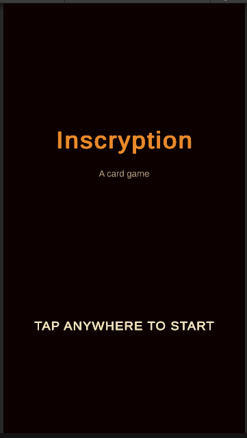
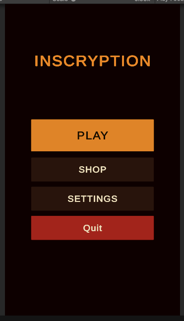
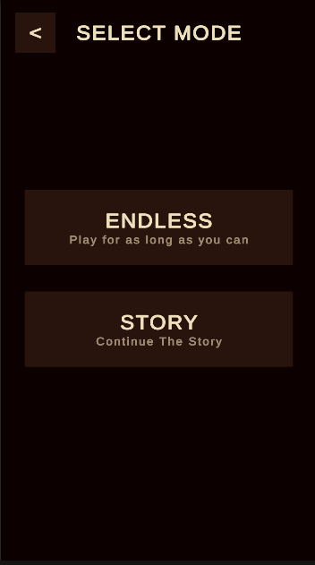
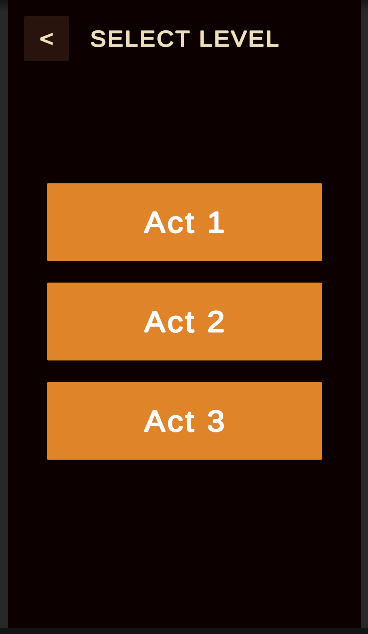
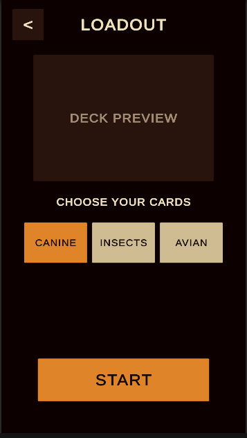
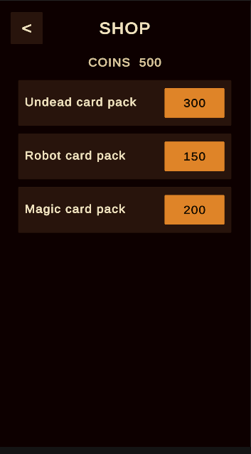
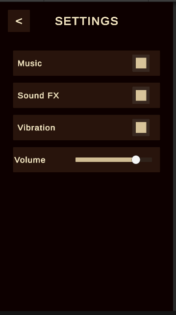
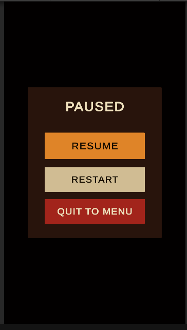
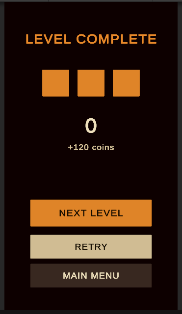

# Lab 07

**Name:** Hafiz Azfar Umar Sheikh - BSSE23064

## Demo video

https://drive.google.com/file/d/1HWQMn5NED8nF74KyP5TH7xYNvYwJiK2K/view?usp=sharing

## Run instructions

1. Install Unity **6000.3.24f1** via Unity Hub.
2. Clone the repository and add the project folder in Unity Hub, then open it.
3. Open the scene `Assets/Scenes/MM.unity`.
4. In the **Game** view, set the aspect to **1080x1920**.
5. Press **Play**. The game starts on the Title screen.
6. Optional Windows build: launch the `.exe` located in **Builds/**.

## Concept and visual direction

The colour palletes were inspired from the game inscryption, it is a PC game, so I tried to imagine what it would look like as a mobile game and made a very mobile game looking menu for it.

### Palette

| Role                    | Hex       | Use                                  |
| ----------------------- | --------- | ------------------------------------ |
| Background              | `#0A0605` | Screen backgrounds                   |
| Surface                 | `#2B1710` | Panels, secondary buttons, rows      |
| Primary (candle orange) | `#E8892B` | The single primary action per screen |
| Secondary (parchment)   | `#D8C49A` | Cards, toggles, accents              |
| Danger (blood red)      | `#A8281C` | Destructive actions (Quit)           |
| Text (cream)            | `#EFE0BC` | All text on dark fills               |
| Locked / disabled       | `#3A2A22` | Locked levels, tracks                |
| Muted text              | `#A38C73` | Hints, captions                      |
| Dark text               | `#140A06` | Text on orange and parchment fills   |

**Colour harmony:** analogous (red, orange and amber, roughly 5 to 42 degrees on the hue wheel) with near-black browns as the base.

### Typography and layout system

- Type scale (1080 reference): title 96-110, heading 64-84, button 48-72, body 44, caption 40. Nothing below 40 px.
- Spacing in multiples of 8; screen edge margin 48 px.
- Touch targets at least 140 px high (about 56 dp); primary buttons 760 x 150-200 px.
- Anchors: headers top-anchored, primary actions bottom or centre anchored, Back button top-left in the same position on every sub-screen. All screens sit inside a **SafeArea** container that follows `Screen.safeArea`, and the Canvas Scaler uses Scale With Screen Size (1080x1920, match 0.5).

### Tween system

Tweens are custom coroutines (`Assets/Scripts/Tween.cs`) using unscaled time, so animations keep running while the game is paused. Easing functions implemented are: Linear, InQuad, OutQuad, InCubic, OutCubic, InOutSine, OutBack, OutElastic and OutBounce.

| Script                         | Responsibility                                                   |
| ------------------------------ | ---------------------------------------------------------------- |
| `UIManager`                    | Navigation with a back stack: `Go`, `Back`, `Root`, `Replace`    |
| `ScreenBase`                   | Slide and fade transitions for every screen, pop-in for overlays |
| `AnimatedButton`               | Press and release feedback, navigation action, Quit action       |
| `TitleScreen`, `ResultsScreen` | Screen-specific entrance animations                              |
| `StaggerIn`, `LockedLevel`     | Staggered pop-in, shake feedback on locked levels                |
| `SafeArea`                     | Notch and rounded-corner handling                                |

**Global transitions (all screens):**

| Element                 | Tween                      | Ease               | Duration     | Why                                                               |
| ----------------------- | -------------------------- | ------------------ | ------------ | ----------------------------------------------------------------- |
| Screen enters (forward) | Slide from right + fade in | OutCubic / OutQuad | 0.35 s       | Decelerating arrival feels responsive and shows forward direction |
| Screen exits            | Slide left + fade out      | InCubic / InQuad   | 0.25 s       | Accelerating exit gets out of the way quickly                     |
| Going back              | Slide from left            | OutCubic           | 0.35 s       | Reverse direction tells the player they moved up the hierarchy    |
| Button press            | Scale to 0.94              | OutQuad            | 0.08 s       | Instant tactile feedback                                          |
| Button release          | Scale back to 1            | OutBack            | 0.25 s       | Small overshoot feels springy and confirms the tap                |
| Input during transition | `interactable = false`     | n/a                | during tween | Prevents double taps                                              |

---

## Screens

Each section shows: the annotated colour screenshot, the greyscale copy, and the checks made.

### 1. Title

**Purpose:** Entry point. Sets the mood and invites the player to start.

**Principles and techniques:**

- Visual hierarchy: large orange title in the upper third, small cream prompt below.
- Affordance: the prompt pulses so it reads as interactive; the whole screen is one tap target.
- Contrast: orange and cream on near-black.
  **Tweens:**

| Element | Tween              | Ease      | Duration | Why                                         |
| ------- | ------------------ | --------- | -------- | ------------------------------------------- |
| Logo    | Drop in from above | OutBounce | 0.8 s    | Weighty, playful arrival that sets the tone |
| Prompt  | Scale pulse loop   | InOutSine | 0.8 s    | Smooth breathing signals                    |

| Colour                             | Greyscale                                      |
| ---------------------------------- | ---------------------------------------------- |
|  |  |

**Greyscale check:** Survives check, colours are still distinguishable.

### 2. Main Menu

**Purpose:** Hub that leads to every other area.

**Principles and techniques:**

- Visual hierarchy: Play is the only button and with bright fill; secondary actions are smaller and recede.
- Grouping: Shop and Settings sit together; the destructive Quit action is separated by extra spacing.
- Consistency: all buttons share width, rounded corners and bold caps labels.
- Greyscale-driven fixes: secondary buttons were changed to the dark surface colour with cream text so Play is the lightest button in greyscale, and the Quit label was changed to cream (dark text on red was only about 2.6:1).

**Tweens:**

| Element      | Tween                                 | Ease                 | Duration        | Why                                                         |
| ------------ | ------------------------------------- | -------------------- | --------------- | ----------------------------------------------------------- |
| Buttons      | Staggered scale pop-in (0.07 s apart) | OutBack              | 0.35 s          | Stagger leads the eye from the primary action down the list |
| Button press | Scale 0.94 then back                  | OutQuad then OutBack | 0.08 s / 0.25 s | Tap feedback                                                |

| Colour                                    | Greyscale                                             |
| ----------------------------------------- | ----------------------------------------------------- |
|  |  |

**Greyscale check:** Play was initially similar in hue to secondary buttons, so they were very similar. Secondary buttons were darkened and labels set to cream, so the hierarchy now survives without hue.

### 3. Mode Select

**Purpose:** Choose how to play. There are 2 Endless and Story.

**Principles and techniques:**

- Consistency and alignment: equal-sized cards, one column, same left and right margins.
- Affordance: cards look like tappable objects (filled, rounded, with a title and a one-line description).
- Proximity: title and description are grouped inside each card.
- Back button top-left in the standard position.

**Tweens:**

| Element | Tween          | Ease     | Duration | Why                         |
| ------- | -------------- | -------- | -------- | --------------------------- |
| Screen  | Slide and fade | OutCubic | 0.35 s   | Standard forward transition |

| Colour                                        | Greyscale                                                 |
| --------------------------------------------- | --------------------------------------------------------- |
|  |  |

**Greyscale check:** No changes made

### 4. Level Select

**Purpose:** Pick an encounter or level from a grid.

**Principles and techniques:**

- Grid alignment: 3 x 3 grid with equal cells (260 px) and equal spacing (32 px).
- State differentiation: unlocked levels use the orange fill with dark text; locked levels use a dark muted fill with muted text. [If you added a lock icon or label, mention it as the non-colour cue.]
- Feedback: locked levels respond to taps instead of doing nothing.

**Tweens:**

| Element          | Tween                                    | Ease         | Duration | Why                                             |
| ---------------- | ---------------------------------------- | ------------ | -------- | ----------------------------------------------- |
| Locked level tap | Horizontal shake with decaying amplitude | Linear decay | 0.3 s    | A "no" gesture that explains why nothing opened |
| Screen           | Slide and fade                           | OutCubic     | 0.35 s   | Forward transition                              |

| Colour                                          | Greyscale                                                   |
| ----------------------------------------------- | ----------------------------------------------------------- |
|  |  |

**Greyscale check:** No change needed.

### 5. Loadout

**Purpose:** Choose a Deck before starting.

**Principles and techniques:**

- Hierarchy: preview area is the largest element; Start is the single bright primary action at the bottom.
- Selected state: the selected option uses the accent fill, others use the secondary fill.
- Anchoring: Start is anchored bottom-centre, within thumb reach.

**Tweens:**

| Element      | Tween          | Ease              | Duration        | Why                        |
| ------------ | -------------- | ----------------- | --------------- | -------------------------- |
| Screen       | Slide and fade | OutCubic          | 0.35 s          | Forward transition         |
| Start button | Press scale    | OutQuad / OutBack | 0.08 s / 0.25 s | Confirms the commit action |

| Colour                                 | Greyscale                                          |
| -------------------------------------- | -------------------------------------------------- |
|  |  |

**Greyscale check:** The selected type is slightly darker then the non selected ones

### 6. Shop

**Purpose:** Spend coins on items.

**Principles and techniques:**

- Grouping: each item row holds its name and price button together.
- Alignment: names left-aligned, price buttons right-aligned in a consistent column.
- Colour meaning: the accent colour marks the price button as the call to action.
- Coin counter at the top for context.

**Tweens:**

| Element       | Tween          | Ease              | Duration        | Why                |
| ------------- | -------------- | ----------------- | --------------- | ------------------ |
| Screen        | Slide and fade | OutCubic          | 0.35 s          | Forward transition |
| Price buttons | Press scale    | OutQuad / OutBack | 0.08 s / 0.25 s | Tap feedback       |

| Colour                           | Greyscale                                    |
| -------------------------------- | -------------------------------------------- |
|  |  |

**Greyscale check:** Price colours do not blend with background

### 7. Settings

**Purpose:** Adjust music, sound effects, vibration and volume.

**Principles and techniques:**

- Alignment and consistency: every row has the label on the left and the control on the right at the same height.
- Affordance: toggles and a slider use familiar shapes with large touch targets (110 px toggles).
- State cue: toggle ON is shown by a checkmark and colour, not hue alone.

**Tweens:**

| Element         | Tween           | Ease     | Duration | Why                           |
| --------------- | --------------- | -------- | -------- | ----------------------------- |
| Screen          | Slide and fade  | OutCubic | 0.35 s   | Forward transition            |
| Back navigation | Slide from left | OutCubic | 0.35 s   | Shows the player is returning |

| Colour                                   | Greyscale                                            |
| ---------------------------------------- | ---------------------------------------------------- |
|  |  |

**Greyscale check:** When an option is On/Off you can still visually tell it apart from the background

### 8. Pause

**Purpose:** A modal overlay that interrupts gameplay with Resume, Restart and Quit.

**Principles and techniques:**

- Modal focus: a 70% black dim covers the game and a centred panel holds the actions.
- Hierarchy: Resume is the orange primary action; Restart is secondary; Quit uses red with cream text and is placed last.
- Consistent button widths and spacing inside the panel.

**Tweens:**

| Element | Tween                 | Ease    | Duration | Why                                                               |
| ------- | --------------------- | ------- | -------- | ----------------------------------------------------------------- |
| Dim     | Fade in               | OutQuad | 0.35 s   | Smoothly shifts focus                                             |
| Panel   | Scale from 0.8 to 1   | OutBack | 0.35 s   | Pops like a card placed on a table and reads as a temporary layer |
| Exit    | Fade and scale to 0.9 | InQuad  | 0.25 s   | Quick, quiet dismissal                                            |

| Colour                             | Greyscale                                      |
| ---------------------------------- | ---------------------------------------------- |
|  |  |

**Greyscale check:** Survives greyscale.

### 9. Results (Level Complete)

**Purpose:** Reward the player and offer the next step.

**Principles and techniques:**

- Hierarchy: heading, stars, then score from top to bottom; Next is the only orange button.
- Grouping: Next, Retry and Menu are a stacked group with decreasing emphasis (accent, secondary, muted).
- Reward feedback: stars and score animate in sequence.

**Tweens:**

| Element | Tween                                              | Ease       | Duration | Why                                                   |
| ------- | -------------------------------------------------- | ---------- | -------- | ----------------------------------------------------- |
| Stars   | Scale from 0 to 1, one after another (0.2 s apart) | OutElastic | 0.5 s    | Bouncy pop makes each star feel earned                |
| Score   | Count up from 0                                    | OutCubic   | 1.2 s    | Fast start, gentle finish emphasises the final number |

| Colour                                       | Greyscale                                                |
| -------------------------------------------- | -------------------------------------------------------- |
|  |  |

**Greyscale check:** The three colours are disinguishable from each other.

### 10. Credits

**Purpose:** Acknowledge references, tools and assets.

**Principles and techniques:**

- Readability: cream text on a dark surface panel, 44 px body text, centred headings.
- Consistency: same header and Back button position as other sub-screens.

**Tweens:**

| Element | Tween          | Ease     | Duration | Why                |
| ------- | -------------- | -------- | -------- | ------------------ |
| Screen  | Slide and fade | OutCubic | 0.35 s   | Forward transition |

| Colour                                 | Greyscale                                          |
| -------------------------------------- | -------------------------------------------------- |
|  |  |

**Greyscale check:** [Fill in.]

---

## Credits and references

- **Visual inspiration:** _Inscryption_ (Act 1). Colour palette and mood only; no assets were used.
- **Easing equations:** Robert Penner's easing functions, implemented by the author in `Tween.cs`.
- **Font:** Liberation Sans, included with Unity's TextMesh Pro package (SIL Open Font License).
- **Engine:** Unity 6.3 LTS (6000.3.24f1), TextMesh Pro, Universal Render Pipeline.
